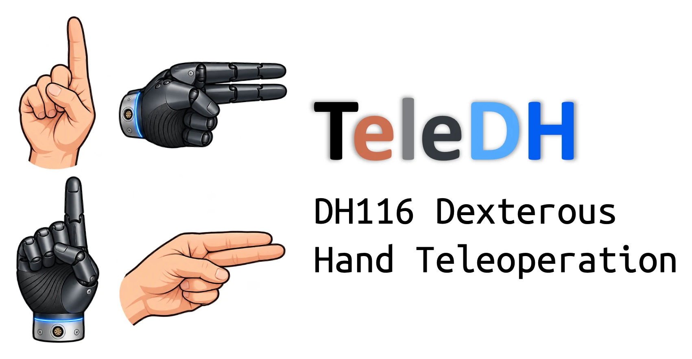
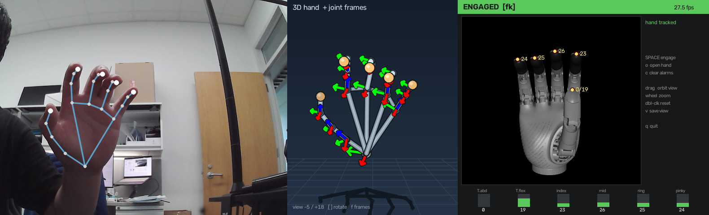

<p align="center">
  
</p>

Camera-driven teleoperation of the DH116 (LHandPro `LAC_DOF_6`) dexterous hand.
Hold your right hand up to a webcam; the robot hand copies it.

```
webcam --> MediaPipe HandLandmarker --> FK retargeter --> clamp / rate-limit / stall kick --> RS485
           21 world landmarks           6 joint angles      Hand.write_angles()               DH116
                     |
                     +--> phantom 3-D hand view (visualisation only, never touches control)
```

The stable path is **scalar FK teleop** (`--mode fk`, the default): the
operator's fingertip layout is expressed in the robot's palm frame and a damped
Gauss-Newton solve finds the six actuator angles whose forward kinematics match
it. Everything under `telehand/experimental/` is research tooling and is
neither imported nor constructed by that path unless an explicitly experimental
flag or subcommand asks for it.

This is the preferred version of the project, on `main`. It merges the
reorganized package layout with the stable scalar-FK baseline that was tagged
`stable-scalar-fk-2026-09-16` on the `stable-scalar-fk` branch: the phantom
3-D hand view, the latency profiler, the serial-flush bypass and the
experimental tooling.

## Quick start

```bash
export DISPLAY=:1 && cd ~/telehand
python3 run.py teleop --smoothing 0.7 --deadband 0.4 --max-speed 300 --no-serial-flush
```

With the phantom 3-D hand view beside the camera image:

```bash
python3 run.py teleop --show-3d-pose --smoothing 0.7 --deadband 0.4 --max-speed 300 --no-serial-flush
```

Add `--show-joint-frames` to draw every articulated joint's local XYZ frame on
the phantom, `--latency-csv lat.csv` to keep the per-frame timing profile.

Why those settings: measured on this rig, `--smoothing 0.7` removes 48 ms of
EMA lag while output jitter stays far below the deadband; `--no-serial-flush`
removes the vendor's per-write `tcdrain` (27 % less command latency, ordering
preserved); `--max-speed 300` opens the host rate limit so the firmware
velocity is what governs. `run.py teleop --help` prints the same recommendation.

The hand **homes first** (drives every joint through its range; keep it clear),
then teleop starts **paused**. Keys in the window:

| key | |
|---|---|
| `SPACE` | engage / pause |
| `o` | open the hand and disengage |
| `c` | clear alarms |
| `p` / `f` | toggle the phantom view / its joint frames |
| `[` `]` | rotate the phantom view |
| drag, wheel, `hjkl`, `r`, `v` | orbit / zoom / reset / save the robot view |
| `q` or `Esc` | quit |

Before the first session on a machine:

```bash
python3 run.py check                   # camera, tracking, hand link; never moves the hand
python3 run.py cameras --use icspring  # remember the camera
python3 run.py profile --name you      # ~10 s, no motors: per-finger scaling and pinch gap
```

`run.py stop` ends a running session cleanly from another terminal (motors
stopped, de-energized, serial closed). Only one session can hold the hardware;
a second one is refused.

## Hardware and software assumptions

Probed on this machine, not assumed:

| | |
|---|---|
| Hand | DH116 / LHandPro `LAC_DOF_6`, **right** hand, 6 active DoF of 11, RS485 @ 500 000 baud on `/dev/ttyUSB0` (FTDI FT231X), node id 1 |
| Joint limits | read from the firmware at startup: thumb abduction 0-60 deg, thumb flexion 0-30 deg, four finger flexions 0-80 deg |
| Camera | any V4L2 webcam at 640x480 MJPG, about 30 fps. Default `/dev/video2` icSpring (29.8 fps measured); alternative `/dev/video0` Innomaker U20CAM-1080p (29.5 fps) |
| Operator | one **right** hand, seen through a mirrored (selfie) camera image (`--mirror`, on by default) |
| Python | 3.12, no system packages: dependencies live in the project-local `vendor/` (mediapipe 1.0 Tasks API, opencv, numpy, scipy, pyserial, mujoco) |
| Display | an X display for the OpenCV window (`export DISPLAY=:1` when working over SSH) |

`/dev/ttyACM0` and `/dev/ttyACM2` (CH343 serial) and `/dev/ttyACM1` (Paxini
tactile-sensor adapter) are also present but do not answer the LHandPro
protocol; they are something else.

## Setup

Already done in this directory, but to reproduce: this machine has no `pip`,
no `venv`, and `sudo` needs a password, so dependencies live in a project-local
`vendor/` directory installed with pip's standalone zipapp.

```bash
curl -sSL -o scripts/pip.pyz https://bootstrap.pypa.io/pip/pip.pyz
python3 scripts/pip.pyz install --target vendor mediapipe opencv-python numpy scipy pyserial
curl -sSL -o models/hand_landmarker.task \
  https://storage.googleapis.com/mediapipe-models/hand_landmarker/hand_landmarker/float16/1/hand_landmarker.task
```

The MuJoCo hand view additionally needs `mujoco`, `glfw` and `PyOpenGL`;
without them the panel falls back to a convex-hull renderer. Nothing is
installed system-wide. `rm -rf vendor scripts/pip.pyz` undoes all of it.

`run.py` puts `vendor/` on `sys.path` before importing anything
([bootstrap.py](telehand/bootstrap.py)). A standalone script does the same by
calling `telehand.bootstrap.bootstrap()` first; see
[scripts/tactile_probe.py](scripts/tactile_probe.py) for the pattern.

## The window

Three columns: the camera image with the tracked skeleton, the phantom 3-D
hand (when `--show-3d-pose` is on or `p` was pressed), and the robot panel.



*`teleop --show-3d-pose --show-joint-frames`, engaged in `fk` mode at 27.5 fps:
an open hand with the thumb out, the phantom with every joint's local frame,
and the DH116 model at the commanded angles (thumb 0/19, fingers 23-26 deg).*

**Phantom 3-D hand** ([phantom.py](telehand/phantom.py)): a motion-capture
style skeletal hand built from MediaPipe's 21 world landmarks, with the
chirality decided from the geometry ([handpose.py](telehand/handpose.py)) so
the phantom cannot flip when MediaPipe's handedness label flickers. It is
visualisation only: it renders after the command has gone out, owns its own
state, and `render()` never raises. Costs about 1.5 ms per frame, 3.7 ms with
joint frames; `--pose-hz` throttles it below the camera rate.

**Robot panel** ([viz.py](telehand/viz.py), [handview.py](telehand/handview.py)):
the hand drawn from the vendor model, driven by the **commanded** angles, what
actually went out over RS485 after clamping and rate limiting, not by the raw
tracker output. If the hand cannot keep up with you, or a joint is pinned at its
limit, the panel shows that rather than hiding it. Bars turn red on an alarm.
`--show-measured` outlines the pose the hand actually reached over the commanded
one. See [Hand view](#hand-view) for the renderer and its controls.

## Commands

```bash
python3 run.py check            # camera, tracking and hand link; no motion
python3 run.py cameras          # list capture devices; --use remembers one
python3 run.py profile          # measure this operator's hand for fk mode (no motors)
python3 run.py teleop           # live teleoperation (see Quick start)
python3 run.py jog              # drive joints by hand; measure a pose's robot side
python3 run.py calibrate        # record tracker signals for the pose library (poses mode)
python3 run.py handview         # render the hand from its URDF; no camera, no motors
python3 run.py latency lat.csv  # re-print the stage-timing summary for a recorded run
python3 run.py touchscan        # map contact geometry with the tactile sensors
python3 run.py photostep        # park joints at preset angles for calibration photos
python3 run.py stop             # end the running session cleanly
```

Useful `teleop` flags:

```bash
python3 run.py teleop --dry-run           # track and display, never move the hand
python3 run.py teleop --no-home           # skip homing (only if already homed)
python3 run.py teleop --hand Left         # track your left hand instead
python3 run.py teleop --camera 0          # use the Innomaker instead
python3 run.py teleop --max-current 300   # gentler grip force (per-mille)
python3 run.py teleop --record run.csv    # log signals + commands; landmarks to run.npz
```

`check` opens a preview window with the live detection rate so you can fix
your framing first. If it reports a different hand than you expected: MediaPipe
labels handedness assuming a mirrored, selfie-style view, which `--mirror` (on
by default) provides, so the label matches the hand you actually held up. The
robot is a **right** hand; driving it with your left works (only per-finger
curl is used, which has no handedness) but the thumb feels mirrored.

## Retargeting modes

`teleop --mode` selects how your hand becomes joint angles. All four are kept so
they can be compared on the same hand.

| mode | what it does | strengths |
|---|---|---|
| `fk` (default) | kinematic: your fingertip layout is expressed in the robot's palm frame, scaled by palm width, and a damped Gauss-Newton solve finds the six actuator angles whose forward kinematics match it ([fkretarget.py](telehand/fkretarget.py)) | any pose has geometric meaning; no anchors to record |
| `poses` | pose library: your recorded poses blended by similarity ([poses.py](telehand/poses.py)) | recorded poses (pinches!) are reproduced exactly |
| `direct` | vendor-style: smooth the 21 landmarks (EMA + Kalman), 2D bend angle per joint, linear map to each actuator ([direct.py](telehand/direct.py)) | 1:1, responsive, no anchors needed |
| `hybrid` | `direct` for the four fingers, `poses` for the two thumb joints | responsive fingers + a thumb that still pinches |

`fk` rests on [kinematics.py](telehand/kinematics.py): vendor URDF geometry, the
MJCF coupling polynomials, a finger stroke-to-angle curve measured from photos
(0/20/40/60/80 -> 0/19.4/35.4/50.1/62.6 deg), a thumb curve fitted to tactile
contacts (`data/touch_grid.json`), and the measured abduction-dependent flexion
envelope. Matched quantities are thumb-to-finger, neighbouring-finger and
palm-to-finger vectors plus the thumb's pointing direction; there is
deliberately no palm-to-thumb term, because the two thumbs sit differently on
their palms. `--record` in any mode also writes the 21x3 world landmarks and
the 2-D image landmarks to a `.npz` next to the CSV.

**Per-operator profile.** Hands differ in proportion, and a single palm-width
scale cannot absorb that. Before an operator's first session:

```bash
python3 run.py profile --name zhang            # ~10 s, no motors
python3 run.py profile --name li --out calibration/handprofile_li.json
python3 run.py teleop --hand Right --profile calibration/handprofile_li.json
```

An open flat hand gives each finger's length (the solver then scales every
finger by its own ratio to the robot's), and a real thumb-index pinch gives
the tracker's residual gap for this hand (MediaPipe leaves 2-3 cm of air),
which sets the pinch-closure intent threshold. `teleop` loads
`calibration/handprofile.json` automatically when it exists.

Three behaviours sit on top of the solve in `fk` mode:

- **Tactile pinch closure** (`--no-tactile` to disable): when your thumb is
  within about 35 mm of a fingertip, that finger keeps curling past the
  solution until the thumb-tip sensor feels contact or the finger stalls
  against the thumb; a stall with no pressure means it is jammed on the thumb's
  side, and it backs off. Sensor ids, layout and API notes:
  [docs/tactile.md](docs/tactile.md).
- **Thumb extended**: a straight thumb clear of every fingertip (open hand,
  thumbs-up) is sent to `[0, 0]` outright, the hardware's best rendering of
  both, measured with `jog`, instead of the solver's compromise.
- **Fingers wait for the thumb**: the abduction joint is slow to let go. While
  it still sits more than 6 deg across from where it was sent, the fingers hold
  their curl rather than closing into its path.

Known hardware limit: thumb abduction sticks on the way back (60 -> 0 can stop
at 15-25 deg) and large thumb moves stop short while the firmware reports them
as reached (see [docs/experiments.md](docs/experiments.md)). The stall kick
recovers most cases; the rest needs the vendor's drive parameters.

`poses` needs a calibrated pose library: `run.py calibrate` walks through the
pose plan (open, the four thumb-to-finger pinches, fist), stores the tracker
signals for each pose in `calibration/poses.json` beside the robot joint angles
measured with `jog`, and the retargeter blends between them. Poses whose robot
joints are only estimates are excluded by default (`--allow-estimates`).

`direct` is a re-implementation of the pipeline inside Leadtron's own
`hand_detector` (recovered from the shipped Windows bundle): the same landmark
triplets, `bend = 180 - angle`, and the same smoothing constants. In
`direct`/`hybrid`, press **`1`** with an open hand and **`2`** with a fist
(20 frames each) to set the per-joint ranges; they are saved to
`calibration/direct_calibration.json`. Tuning: `--lm-alpha` (EMA, vendor 0.3),
`--lm-deadband` (vendor 0.02), `--no-kalman`.

## Latency profiling

Every teleop run prints a p50/p95/p99 table of per-stage timings at exit:
`wait`, `frame_age`, `track` (MediaPipe), `retarget`, `write` (RS485),
`3D hand view` (when on), `display`, `loop`, and the command path
`CAMERA->RS485`. `--latency-csv PATH` keeps the per-frame rows;
`run.py latency PATH` re-prints the summary later. Reference numbers for the
recommended settings: command path about 30 ms p50 at 29 fps. Host-side only:
the camera's own exposure/transfer delay and the motor's travel time (200-530
ms for a full 80 deg finger close) are not in it. Details and the measurements
behind the recommended flags: [docs/experiments.md](docs/experiments.md).

## Choosing a camera

```bash
python3 run.py cameras
```

Lists every capture device with a measured frame rate and a path that survives
replugging. `--camera` takes an index, a `/dev` node, a `by-path` link, or a
name fragment:

```bash
python3 run.py teleop --camera icspring
python3 run.py teleop --camera /dev/v4l/by-path/pci-0000:13:00.4-usb-0:2:1.0-video-index0
```

Two things make bare indices unreliable. Device numbers shuffle when cameras are
plugged in a different order (the icSpring has been `/dev/video2` and
`/dev/video0` on different days), and two identical Innomakers report the same
serial, so `by-id` cannot separate them. `by-path` is keyed on the USB port and
stays unique; a name fragment is refused when it matches more than one camera.

Opening a camera also waits about 1.5 s for auto-exposure to settle. Without it
the first frames come back blown out or black, which reads as a dead device.

## Hand view

The robot panel draws the hand from the vendor model, driven by the same angles
that go out over RS485. Two backends, picked automatically:

| backend | how | cost |
|---|---|---|
| MuJoCo (preferred) | renders the vendor MJCF with real meshes and lighting; needs a GL context | 0.15 ms/frame |
| convex hulls | each link's STL reduced to a sampled point cloud, drawn as its projected hull; pure numpy + cv2 | 2.4 ms/frame |

```bash
python3 run.py handview --pose 10,15,45,0,0,0            # no camera, no motors
python3 run.py handview --poses calibration/poses.json   # n/N walks the anchors, hjkl orbits
python3 run.py teleop --show-measured                    # outline where the hand actually is
```

`--show-measured` renders the measured pose as well and keeps only its
silhouette, drawn over the commanded one. A joint that has not arrived (thumb
abduction sticking on its way back, a finger blocked by the thumb) shows up as
two outlines pulling apart, instead of having to be read off the numbers.

Each joint's value is printed beside the finger it drives (the thumb shows
`abduction/flexion`), with one compact row of vertical bars underneath for the
position within each joint's travel.

The view is driven with the mouse, inside the rendered rectangle only, so
dragging over the camera image or the phantom never moves it:

| | |
|---|---|
| drag | orbit |
| wheel | zoom |
| double click | back to the default view |
| `v` | save the current angle to `.telehand/view.json` |
| `hjkl` / `r` | keyboard equivalents |

Both `teleop` and `jog` share the saved viewpoint, so an angle found while
measuring a pose in `jog` is the one teleop starts with.

The MJCF is the same hand as the URDF, rotated 180 deg about z: link-to-link
distances agree to 0.0 mm. Fingertips need care, though. MuJoCo recentres mesh
vertices on the centroid, so the vertex furthest from the mesh origin is
whichever end of the pad is further from its middle, often the root. Tips are
therefore measured from the body origin, which brings the two models into exact
agreement; before that fix they disagreed by up to 40 mm and the tip markers sat
mid-phalanx.

**Self-contact.** The MJCF ships with collisions off; the renderer turns them
on. The meshes are rigid while the real fingertips are rubber, so wherever the
hand is genuinely pressing on itself the two links overlap. That overlap is
marked with a ring on the view, larger and redder with depth, and listed in
the side column as `thumb-middle 8mm`. It is not a modelling error worth
removing: both pinch poses come out at exactly 0 mm; only `fist` and `point`
overlap, and those are poses where the real thumb does press on the fingers.

The framing solves itself per viewpoint: the hand is rendered onto an oversized
canvas, measured where it actually lands, then scaled by distance and centred
by cropping. Solved once per viewpoint and cached, so a steady view costs
0.2 ms a frame.

## Stopping a session

The hand and camera are single-access devices, and a teleop loop that is still
engaged keeps driving motors whether or not anyone is watching. Only one
telehand session may hold them at a time.

```bash
python3 run.py stop      # ends the running session cleanly
```

Pressing `q` in the window does the same thing. Both take the normal shutdown
path: motors stopped, de-energized, monitor thread joined, serial closed.

Starting a second session while one is running is refused, naming the one that
holds the hardware:

```
ERROR: another telehand session is already running: `teleop` (pid 47170, started 14:53:52).
  Stop it with:  python3 run.py stop
```

The running pid is recorded in `.telehand/session.lock`. It has to be the pid of
the Python process itself: signalling a wrapper shell does not reach the process
underneath, which leaves the hand running with nobody supervising it. A lock
left behind by a crash (`kill -9`) is detected as stale and cleared on the next
run.

## Unplugging the hand

Shut down in software first (`run.py stop`, or `q` in the window). That
**de-energizes the motors**: motion is halted, the drivers are disabled, and
current drops to zero. The hand goes limp, so anything it was gripping will be
released.

Pulling the USB cable is not a substitute. That cable carries RS485 data only
(the hand is powered separately), so unplugging it leaves the motors enabled
and still holding force, with the firmware receiving no stop command. The SDK
documents no watchdog or link-loss behaviour.

`stop_motors()` alone is not enough either: it ends the current move but leaves
the drivers energized. Measured after what used to be a clean shutdown, all six
motors still read `enable=True` drawing 18-117 units of current. Disabling is
what actually lets go, and `disconnect()` does it. Pass `--keep-enabled` to
`teleop` or `jog` to leave the motors holding on exit.

## Safety

Layered, so a tracking glitch cannot become a slammed finger:

- Every command is **clamped** to the limits the firmware reports.
- Joint motion is **rate-limited** host-side (`--max-speed`, default 180 deg/s)
  on top of the firmware's own 150 deg/s velocity limit.
- **Current limited** to 500 per mille by default, which caps grip force.
- **Stall kick**: the worm-drive joints stick (asked for 15 deg, the thumb
  flexion parked at 9 deg with every pinch missing). If a joint sits short of a
  steady target without moving, the command is briefly overshot by 8-12 deg to
  break static friction, then restored. `--no-stall-kick` disables it.
- Teleop **starts paused**; you engage deliberately.
- **Losing tracking holds the last pose** rather than snapping anywhere.
- Quitting, `Ctrl+C`, `SIGTERM`, `run.py stop` or any error stops the motors,
  **de-energizes** them and closes the bus. Only a forced `kill -9` skips that,
  and it leaves motors enabled.
- `--dry-run` connects and tracks but never enables or moves the motors.
- Only one session can hold the hand at a time.
- Known hardware behaviour (see [docs/experiments.md](docs/experiments.md)):
  thumb abduction sticks on the way back; large thumb moves stop short (about
  22 deg of a 60 deg abduction, 9 deg of a 30 deg flexion) and the firmware
  reports them as reached.

## Tests

No hardware, camera or MediaPipe needed; fixtures are in `tests/data/`.

```bash
python3 -m pytest                        # with pytest on the path
python3 tests/test_control_replay.py     # or each module on its own
```

`tests/test_control_replay.py` is the regression guard: the FK retargeter's
output on a bundled recording is frozen in `tests/data/control_reference.npz`,
and any change to the control path that alters a commanded angle fails there
before it can reach the hand. It also asserts that rendering the phantom view
between frames leaves every command bit-identical. `test_handpose.py` checks
the frame geometry on synthetic hands, `test_phantom.py` the renderer (and
writes a montage of representative poses to the system temp directory),
`test_framemap.py` the experimental frame mapper.

Lint and format with `ruff check` and `ruff format` (configuration in
`pyproject.toml`).

## Experimental tools

Isolated under `telehand/experimental/`, labelled `[experimental]` in
`run.py --help`, and never loaded by plain teleop. Findings are recorded in
[docs/experiments.md](docs/experiments.md).

- `run.py teleop --pose-mode frames`: frame-based control of thumb and index
  from the wrist-local joint frames (kept for comparison; it felt less stable
  than the FK solver). `--pose-log` records both signal sets side by side.
- `run.py frames --replay rec.npz`: replay a `--record` recording as
  wrist-local joint frames with stability metrics. The maths is in
  [docs/frames.md](docs/frames.md).
- `run.py stepresponse`: **moves the hand**; measures per-joint actuator step
  response. `scripts/stepresponse_summary.py` and
  `scripts/host_vs_raw_summary.py` summarise the traces in `data/benchmarks`.
- `--skip-unchanged`: fewer serial transactions per frame (about 3 % gain).

## Layout

```
run.py                      entry point: puts vendor/ on sys.path, runs the CLI
telehand/
  bootstrap.py              vendor/ and cmeel path setup, native log quieting
  paths.py                  every file and directory the project uses
  cli.py                    argument parser and command dispatch
  commands/                 one module per subcommand (teleop, check, jog, latency, ...)
  sdk.py                    loads the vendor LHandProLib .so; runtime --no-serial-flush patch
  hand.py                   clamping, rate limiting, stall kick; the only path to RS485
  camera.py                 camera discovery and newest-frame V4L2 capture
  tracker.py                MediaPipe -> 21 world landmarks + 6 scalar signals
  fkretarget.py             the FK retargeter (fingertip geometry -> 6 angles) + pinch closer
  kinematics.py             DH116 URDF geometry, coupling, measured drive curves
  poses.py, direct.py       alternative retargeters (--mode poses / direct / hybrid)
  profile.py                per-operator hand measurements for fk mode
  touchscan.py              tactile contact sweeps
  latency.py                per-stage profiler
  viz.py, handview.py       robot panel (MuJoCo / convex-hull render of the commanded pose)
  phantom.py                phantom 3-D hand view (visualisation only)
  handpose.py               canonical right-hand landmarks + wrist-local joint frames
  session.py                one-instance lock and clean stop
  experimental/             not on the stable path (see docs/experiments.md)
    framemap.py             frame-based joint mapping   (--pose-mode frames)
    frameviz.py             hand-frame replay viewer     (run.py frames)
    stepresponse.py         actuator characterisation    (run.py stepresponse, moves the hand)
    cli.py                  their subcommands
tests/                      pytest suite; fixtures in tests/data/
scripts/                    tactile_probe.py, benchmark summaries, pip.pyz
calibration/                poses.json (pose library), handprofile*.json, *_calibration.json
data/                       measurements: touch_grid.json, abd_envelope.json, photos/, recordings/
                            (benchmarks/, logs/, screenshots/ are generated and git-ignored)
docs/                       architecture.md, experiments.md, frames.md, tactile.md, DH116 manual, images/
models/                     hand_landmarker.task
third_party/                LHandProLib SDK, DH116 URDF and MJCF packages
vendor/                     project-local Python dependencies
.telehand/                  runtime state: camera choice, view angle, mesh cache, session lock
somehand/, AnyDexRetarget/  sibling retargeting projects adapted to this hand (below)
```

Every path above is defined once, in [paths.py](telehand/paths.py). `data/`
has its own [README](data/README.md) describing each measurement file.

## Documentation

| document | contents |
|---|---|
| [docs/architecture.md](docs/architecture.md) | data flow of the stable path, the visualisation side path, safety layers, command dispatch, where files are written |
| [docs/experiments.md](docs/experiments.md) | what the profiling and characterisation tools measured, and the settings they led to |
| [docs/frames.md](docs/frames.md) | wrist-local joint frames from MediaPipe landmarks: conventions and derivation |
| [docs/tactile.md](docs/tactile.md) | DH116 tactile sensor ids, taxel layout and API notes |
| [data/README.md](data/README.md) | each measurement file under `data/` |

### Vendor resources

The DH116 is made by Shenzhen Lingqiao Drive and Control Technology (Leadtron
in its own manuals) and sold as the Leadshine DH116. What this repository
bundles, and where it came from:

| resource | bundled copy | source |
|---|---|---|
| DH116 / DH116P user manual | [docs/DH116_user_manual.pdf](docs/DH116_user_manual.pdf) | [Leadshine store (PDF)](https://store.leadshine.com/cdn/shop/files/DH116_DH116P_Series_Dexterous_User_Manual.pdf) |
| LHandProLib SDK (C++ with Python examples, RS485 / CAN FD / EtherCAT) | `third_party/LHandProLib-API-Linux-20260727/` | [SDK manual (PDF)](https://store.leadshine.com/cdn/shop/files/DH116S_LHandProLib_SDK_Manual.pdf); packages are distributed by the vendor and resellers |
| LHandPro host software (Windows, for wiring checks) | not bundled | [software manual (PDF)](https://store.leadshine.com/cdn/shop/files/DH116_DH116P_LHandPro_Software_User_Manual.pdf) |
| URDF and MJCF models, left and right hand | `third_party/DH116_URDF_MJCF_Files/` | ships with the SDK package |
| product page with the current SDK, URDF and ROS 2 downloads | - | [OpenELAB: Leadshine DH116](https://openelab.io/sv/products/leadshine-dh116-robotic-dexterous-hand) |

The user manual notes that units built before 2026-02-10 need the older
resource packages; the SDK bundled here (`20260727`) is the one this hand
was tested with. The vendor packages are kept exactly as shipped (see
`.gitattributes`); the only change this project makes is the runtime
`--no-serial-flush` patch applied in memory by [sdk.py](telehand/sdk.py).

## Related projects

Two other retargeting stacks are checked out here so that all three can be
compared on the same hand. Each is a git clone carrying a small local
adaptation for the DH116; keep the upstream diff minimal (`git -C <dir> diff`).

| directory | what it is | where to start |
|---|---|---|
| `AnyDexRetarget/` | optimisation-based retargeting (Pinocchio + NLopt) | `python3 AnyDexRetarget/dh116.py env`, then [README_DH116.md](AnyDexRetarget/README_DH116.md) |
| `somehand/` | MediaPipe + MuJoCo retargeting with an RS485 backend for this hand | `somehand/configs/retargeting/{base,right}/dh116*.yaml` and its own README |

Both reach the hardware through the vendor SDK under `third_party/`, and
AnyDexRetarget drives the hand through `telehand.hand.Hand` itself, so the
safety layer is shared.

## Implementation notes

### Camera capture

Both cameras were benchmarked at 640x480 MJPG. The icSpring (`/dev/video2`) is
the default at 29.8 fps; the Innomaker (`/dev/video0`) manages 29.5.

Two non-obvious things about the capture path:

- `CAP_PROP_BUFFERSIZE = 1` is the usual advice for avoiding stale frames, but
  on the V4L2 backend it **halves** the delivered rate (measured 15 fps on both
  cameras, against 30 without it). It is not set.
- Leaving the queue at its default means a slow consumer falls behind and you
  end up teleoperating from frames a few hundred ms old. A reader thread that
  keeps only the newest frame solves that without costing frame rate. Each
  frame is timestamped when it arrives, which is what `frame_age` in the
  latency table reports.

Both cameras default to aperture-priority auto-exposure, which can also drop the
rate in dim light. If frame rate sags, add more light on your hand rather than
forcing a manual exposure; the tracker needs the contrast anyway.

### Serial writes

One `write_angles` is seven serial transactions: six `set_target_angle` plus
`move_motors`. The vendor serial layer calls `tcdrain` after each, which cost
12 ms per frame regardless of how many joints were sent; `--no-serial-flush`
patches that out at runtime ([sdk.py](telehand/sdk.py)) without touching the
vendor tree, and ordering is preserved by the write lock and the tty FIFO.
Reading angles is free (served from the monitor thread's cache). RS485 here is
fire-and-forget, so `--skip-unchanged` is paired with a periodic full resend
(`--resync-frames`) so a dropped frame cannot leave a stale target.

### How a finger angle is derived

The scalar signals come from MediaPipe's `hand_world_landmarks` (metric and
hand-relative) rather than image coordinates, so readings hold steady as you
move toward or away from the camera.

- **Finger flexion**: the total bend along the finger, the turn at the PIP
  joint plus the turn at the DIP joint. About 0 deg straight, 170 deg fully
  curled.
- **Thumb abduction**: the angle at the wrist between the thumb MCP and the
  index MCP. Measured at the MCP, not the tip, so thumb *curl* (which happens
  further out) does not leak into the abduction reading.

The `poses` mode stores the raw value at both the open and fist pose per signal
and interpolates between them, so the mapping self-corrects for direction. The
default `fk` mode does not use these signals for control at all; it works on
the fingertip geometry directly.

## Version history

| version | where | what |
|---|---|---|
| 0.2.0 | `main` | this version: reorganized layout plus the stable scalar-FK baseline (phantom 3-D view, latency profiler, serial-flush bypass, experimental tools, tests) |
| 0.1.0 | `main` before this merge | reorganized package layout (`cli.py` + `commands/`, `paths.py`, `calibration/`, `data/`) on the 2026-09-14 code |
| baseline | branch `stable-scalar-fk`, tags `stable-scalar-fk-2026-09-16`, `scalar-fk-clean-2026-09-16` | the scalar-FK teleop baseline measured in docs/experiments.md, in the original flat layout |
